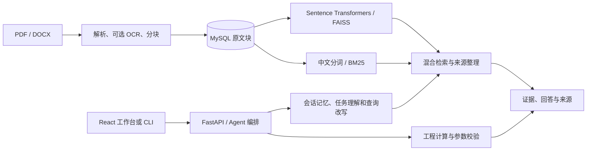

# ThermalAgent

面向热管理工程问题的检索与计算助手。它可以从文档里找出支持某个判断的原文，也可以把给定边界条件交给确定性计算工具。前端分别展示检索来源、计算参数和验证状态，便于追问“依据来自哪里”和“这个数如何得到”。

**先看一次真实检索。** 用 Python 3.11 在仓库根目录运行以下 PowerShell 命令。这个演示只需要 NumPy 和 rank-bm25，无需数据库、模型下载或 API Key。

```powershell
cd project
python -m venv .venv
.\.venv\Scripts\python.exe -m pip install -r requirements-demo.txt
.\.venv\Scripts\python.exe examples/demo.py "并联支路如何分配流量？"
```

演示从六段原创台架笔记建临时索引，调用后端现有的中文分词和 BM25 索引实现，返回命中段落、来源、分数和原文。完整服务在下文使用同一份资料验证向量检索和 Agent。

## 架构与关键实现



- **文档与检索**保留 PDF 文本、表格、可选 OCR、DOCX 段落解析、切分及索引一致性校验。检索结果记录 `doc_id`、`chunk_id`、页码、分数和命中通道。另有来源登记、SQLite/MySQL 暂存与候选索引评价入口。
- **Agent 与工程工具**处理追问指代、任务分类、查询扩展、来源整理和会话更新。热阻、平壁导热、冷却液温升与流量估算走本地公式和物性逻辑。输入不足时，协议会保留缺参或证据不足状态。
- **模型与仿真**保留 Ollama / OpenAI 兼容模型网关、可选任务模型辅助、MATLAB 适配及 Fluent 结果导入边界。PEM 模块可创建研究、生成 DOE 候选并比较导入观测。生成候选和完成外部仿真是两个阶段。
- **工作台**保留 React、Vite、Ant Design、ECharts、会话、工程任务、结果可视化和 PEM 页面。默认通过 `/api` 代理连接后端，前端样例响应须显式启用。

| 目录 | 可检查的实现 |
| --- | --- |
| `project/services/ingest_service/` | 解析、切分、导入、知识暂存 |
| `project/services/retrieval_service/` | FastAPI、Agent、混合检索、记忆、公式与评估 |
| `project/services/{model_gateway,engineering_service,simulation_service,pem_service}/` | 模型调用与工程工作流 |
| `project/scripts/`、`project/services/retrieval_service/sql/` | 数据库初始化、索引管理、回归和建表 SQL |
| `project/examples/`、`project/data/reference/` | 可公开演示语料、示例程序与物性默认值 |
| `thermal-frontend/` | 实际使用的前端源码、npm 锁文件与组件测试 |

## 完整服务 · Windows

环境采用 **64 位 Python 3.11、MySQL 8.0、Node.js 24**。以下命令从 `project` 执行。在新建的专用演示库上操作，导入命令会重建该库的索引映射和配置的本地索引文件。

```powershell
.\.venv\Scripts\python.exe -m pip install -r requirements.txt
Copy-Item .env.example .env
notepad .env
```

把 `MYSQL_PASSWORD` 和 `MYSQL_ROOT_PASSWORD` 改成两个独立的本地密码。模板为演示短文设置了分块大小。常用配置如下。

| 配置 | 示例值／用途 |
| --- | --- |
| `MYSQL_HOST`、`MYSQL_PORT`、`MYSQL_DB` | `127.0.0.1`、`33317`、`thermal_demo` |
| `INDEX_DIR` | `./indexes`，首次导入生成 |
| `EMBEDDING_MODEL` | `sentence-transformers/paraphrase-multilingual-MiniLM-L12-v2`。首次需要模型下载或可读的本地模型目录。 |
| `AGENT_ENABLE_LLM` | `false` 可运行证据抽取和确定性工具 |
| `MODEL_GATEWAY_PROVIDER`、`MODEL_GATEWAY_BASE_URL` | 可选 `ollama` 或 `openai` 兼容服务，密钥由本机配置提供 |
| `RAG_API_KEY` | 可选 Bearer 密钥，本地模板留空；默认启动只绑定回环地址 |

使用已有的独立 MySQL 实例时，为 `thermal_demo` 用户授予该演示库的建表与读写权限。也可在安装 Docker Compose 的环境使用仓内数据库配置。

```powershell
docker compose up -d --wait db
```

数据库就绪后执行以下步骤。DOCX 输出使用新文件名，重复实验时可以复用已生成的文件。

```powershell
$py = '.\.venv\Scripts\python.exe'
& $py scripts/init_db.py
& $py examples/demo.py --export-docx runtime/sample/cooling-notes.docx
& $py -m services.ingest_service.cli ingest runtime/sample/cooling-notes.docx
& $py cli.py validate-index
& $py -m uvicorn services.retrieval_service.v11_api_server:app --host 127.0.0.1 --port 8000
```

在第二个终端，从仓库根目录启动工作台。打开 Vite 输出的本机地址。

```powershell
cd thermal-frontend
npm.cmd ci
npm.cmd run dev -- --host 127.0.0.1
```

### API 示例

```powershell
$base = 'http://127.0.0.1:8000'
Invoke-RestMethod "$base/health"
Invoke-RestMethod "$base/ready"
$body = @{ query = '并联支路流量分配不均时应记录哪些数据？'; top_k = 3 } | ConvertTo-Json
Invoke-RestMethod "$base/retrieve" -Method Post -ContentType 'application/json; charset=utf-8' -Body ([Text.Encoding]::UTF8.GetBytes($body))
$ask = @{ query = '壁厚5mm，导热系数16W/(mK)，面积0.002m²，两侧温差60K，计算平壁导热热流。'; session_id = 'wall-example' } | ConvertTo-Json
Invoke-RestMethod "$base/agent/answer" -Method Post -ContentType 'application/json; charset=utf-8' -Body ([Text.Encoding]::UTF8.GetBytes($ask))
```

在浏览器访问本机 `/docs` 查看完整合同。平壁算例在 `metadata.calculation.tool_result.heat_rate_W` 返回 **384 W**。本次完整验证还得到六个有效块，同一查询的前三项同时具有正的向量和 BM25 分数，Agent 返回三项来源。这些数字针对随仓样本。

## 测试与复现边界

```powershell
# project/
.\.venv\Scripts\python.exe -m compileall -q services scripts cli.py examples
.\.venv\Scripts\python.exe scripts/smoke_test_agent.py
.\.venv\Scripts\python.exe scripts/test_bm25_tokenizer_contract.py
.\.venv\Scripts\python.exe scripts/test_pem_core.py
.\.venv\Scripts\python.exe scripts/test_pem_results.py
# thermal-frontend/
npm.cmd test
npm.cmd run build
```

随仓 smoke 会有意让检索不可用，以验证降级与计算合同。上面的完整导入、HTTP 检索和索引命令可验证正常路径。此次实测覆盖 Windows 本机 MySQL、真实 embedding、FAISS/BM25、HTTP API 和前端测试。OCR 的外部二进制、付费模型、MATLAB、Fluent 求解及容器运行需各自的环境，本次没有为它们给出端到端通过结论。

原教材、企业资料、历史数据库与生产索引均已排除。示例笔记专用于说明接口与证据链。当前语料规模不足以评估行业问答质量，部分物性数据仍待补充来源。下一步可扩充许可清晰的资料，建立独立人工标注检索集，验证外部求解器环境。

## 开发与素材归属

解析、检索、编排、工程工具和工作台来自已有项目。此次 AI 辅助整理负责提取运行文件、修复数据库脚本的可移植性、撰写原创演示笔记，并执行测试和打包。既有工程的逐模块人机贡献比例没有可靠记录。Hyper 主题保留项目原有的爱莉希雅 AI 二创装饰图，权利说明见[素材说明](ASSETS.md)。
